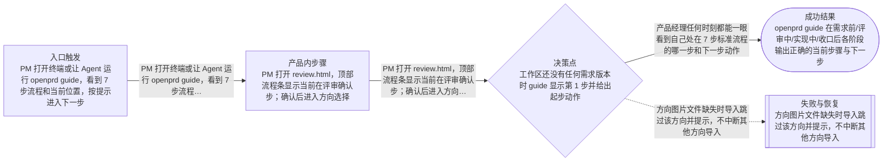

# 流程

## 主流程

- PM 打开终端或让 Agent 运行 openprd guide，看到 7 步流程和当前位置，按提示进入下一步
- PM 打开 review.html，顶部流程条显示当前在评审确认步；确认后进入方向选择
- PM 打开画布点导入评审方向，3 个方向图变成卡片，圈选标注后用发送给 Codex 把结论发回

## Mermaid 流程图

## 边界情况

- 工作区还没有任何需求版本时 guide 显示第 1 步并给出起步动作
- 当前评审没有 designDirections 时画布导入按钮提示暂无可导入方向

## 失败模式

- 方向图片文件缺失时导入跳过该方向并提示，不中断其他方向导入
