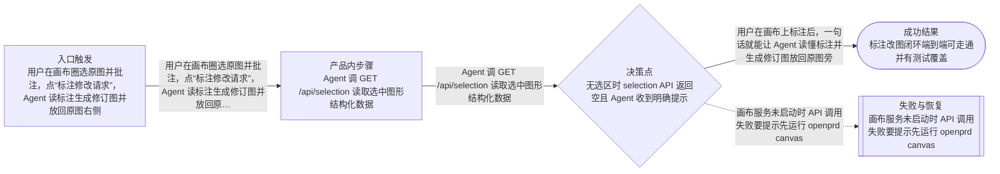

# 流程

## 主流程

- 用户在画布圈选原图并批注，点“标注修改请求”，Agent 读标注生成修订图并放回原图右侧
- Agent 调 GET /api/selection 读取选中图形结构化数据
- Agent 调 POST /api/insert-image 把生成图锚定到指定图形旁
- 用户说“打开画布一起改图”即唤起画布协同

## Mermaid 流程图

## 边界情况

- 无选区时 selection API 返回空且 Agent 收到明确提示
- 锚点图形不存在时 insert-image 报错不写脏数据
- 占位卡无宽高时尺寸契约退化为默认比例

## 失败模式

- 画布服务未启动时 API 调用失败要提示先运行 openprd canvas
- 回填图片文件缺失时保持画布 scene 不变
