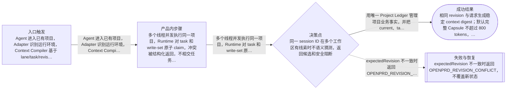

# 流程

## 主流程

- Agent 进入已有项目，Adapter 识别运行环境，Context Compiler 基于 lane/task/revision 在预算内生成 Capsule 或 Delta
- 多个线程并发执行同一项目，Runtime 对 task 和 write-set 原子 claim，冲突被结构化返回，不相交任务可并行
- 业务用户打开 Review，先看到问题、价值、范围、流程、风险和验收；工程视图从同一 model 展示 change/task/file/test/evidence
- 任务完成后 Evidence 只更新相关 task/work-unit 投影；阶段或发布门禁再聚合项目级质量
- 旧项目升级前生成 plan 与 backup，迁移到 dual 模式并验证；失败只回滚当前项目
- Knowledge 由 observation 进入 candidate，经证据验证后生效；过期、冲突或被替代的知识不再进入 Context

## Mermaid 流程图

## 边界情况

- 同一 session ID 在多个工作区有线索时不语义猜测，返回候选和安全阻断
- Agent 崩溃导致 lease 过期后，旧 heartbeat 不能覆盖新 claim
- Ledger JSONL 尾部半写、projection 损坏或 migration 重跑时可恢复且不重复应用
- workspace schema 过新时旧 writer 拒绝写入并说明最小兼容版本
- Home Skill 路径含跨目录 symlink 时拒绝跟随覆盖 canonical source，并给出可恢复迁移计划
- dirty worktree、detached worktree、归档、副本和 nested legacy 目录被明确分类，不误刷新

## 失败模式

- expectedRevision 不一致时返回 OPENPRD_REVISION_CONFLICT，不覆盖新状态
- write-set 冲突时保留当前 claim 并返回冲突任务、owner、lease 与重试条件
- Context 超预算时按 authority、scope、freshness 和 relevance 确定性裁剪，并列出 excluded reason
- 迁移校验失败时用 preimage 恢复当前项目，registry 不提交该项目新版本
- Adapter 能力不足时生成 capability gap，不继续要求不存在的 hook 或 UI
- Review model digest 不匹配时不接受确认，CSS/artifact 重渲染不得改变业务 model digest
