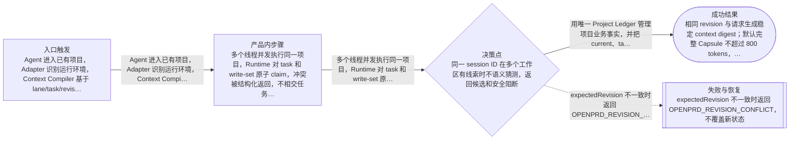

# OpenPrd 可解释项目控制平面与跨工具上下文升级
> 语言规则：用户可见说明、PRD、spec 和 tasks 跟随用户当前主语言；无法判断时才使用简体中文兜底。PRD、OpenPrd、OpenSpec、API、SDK、CLI、TypeScript、JSON、HTTP、WebSocket、字段 key、命令名、品牌名、产品名和协议名等必要专有名词保留原文。
- 版本: v0018
- 负责人: OpenPrd
- 产品场景: 以 Agent 为主要使用场景
- 场景模板: 以 Agent 为主要使用场景
- 状态: synthesized
- 生成时间: 2026-07-10 23:07:12
## 元信息

- 标题: OpenPrd 可解释项目控制平面与跨工具上下文升级
- 负责人: OpenPrd
- 状态: classified
- 版本: v0018
- 产品场景: 以 Agent 为主要使用场景
- 日期: 2026-07-10

## 问题

- 问题陈述: 统一项目事实、并发运行态和上下文编译，降低 token、延迟、错误目标与长期维护成本
- 为什么是现在: 0.1.19 已暴露多真相源、并发和跨版本迁移风险，需要在 0.1.20 建立兼容控制平面
- 证据:
  - 近 30 天 817 个 Codex 线程中，362 个具有 OpenPrd CLI 形态，共 3145 次调用；run --context 554 次，93 个线程重复调用，额外调用 271 次，单线程最多 22 次。
  - 56 个同项目 OpenPrd 线程在 5 分钟内并发启动；当前 feature-list、loop-state、current state 和全局镜像缺少 claim、lease、CAS 与 write-set 冲突协议。
  - 当前 run-harness 已出现 findSessionWorkspaceCandidates 被删除但仍调用，以及显式 session 在精确解析前被 active change 抢占的回归。
  - 当前 v0017 与 remove-session-tracking change 混入前一个 Canvas 需求内容，证明局部 capture 与多投影可以形成语义污染。
  - 本机持久范围发现 86 个 .openprd，版本跨 0.1.0、0.1.11、0.1.15、0.1.19；Home 级 Codex Skill 还被 Claude 适配内容和软链接污染。

## 用户与相关方

- 主要用户:
  - 用自然语言驱动 Codex、Cursor、Claude Code 完成产品开发的非专业或半专业用户
  - 在同一代码项目中并发运行多个 Agent、线程、worktree 的开发者
  - 需要持续维护需求、代码健康、知识与版本迁移的项目负责人
- 次要用户:
  - OpenPrd 集成与插件维护者
  - 审阅业务范围、风险与验收结论的产品和业务协作者
- 相关方:
  - OpenPrd 产品与工程维护者
  - 被 OpenPrd 管理的本地项目所有者
  - Codex、Cursor、Claude Code 适配层维护者

## 目标与成功标准

- 目标:
  - 用唯一 Project Ledger 管理项目业务事实，并把 current、task graph、review、knowledge index 等降为可重建投影
  - 用 Lane/Task Runtime 支持同项目多线程、多 Agent、多 worktree 安全 claim、lease、heartbeat、write-set 与 CAS
  - 用 Context Compiler 向 Agent 提供最精准、最小 token、可缓存、可增量、可解释且默认只读的上下文
  - 用 scoped Evidence 和 Gate 让局部任务不被无关项目债务阻断，同时保持发布级门禁
  - 从同一 ReviewModel 生成小白可懂的业务视图和工程可执行视图，并保持同一 digest 与决策链
  - 统一 Codex、Cursor、Claude Code 的 Adapter SPI、能力协商、事件归一和跨版本协议
  - 把 Knowledge Evolution 变为有作用域、证据、有效期、替代链和可回滚的持续维护系统
  - 安全将产品版本升级到 0.1.20，并刷新所有真实本地 OpenPrd 安装与旧项目
- 成功指标:
  - 相同 revision 与请求生成稳定 context digest；默认完整 Capsule 不超过 800 tokens，Delta 不超过 250 tokens
  - Context warm cache p95 小于 100ms，cold build p95 小于 500ms；run --context 对业务状态零写入
  - 同一 task 的 100 个并发 claim 只允许一个成功；CAS 与 write-set 压力测试零 lost update
  - 显式 session/thread/task/work-unit 目标解析准确率 100%，active change 只在无精确索引时作为 fallback
  - 业务 Review 不泄露内部命令和实现噪声，工程 Review 保持文件、任务、测试、证据和版本全链路可追溯
  - Codex、Cursor、Claude Code 通过同一适配契约 fixture，能力缺口被明确表达而不伪装支持
  - 所有真实活跃本地项目升级到 0.1.20，归档未改动，单项目回滚演练成功，Home Skill 不再出现跨适配器漂移
- 验收目标:
  - 全量单元、集成、并发、迁移、回滚、性能和三平台契约测试通过
  - 最新 Markdown/HTML 测试报告、质量报告、架构与视觉证据可追溯
  - standards、quality、run verify 与 doctor 在发布/刷新前全部健康
  - 所有真实项目刷新报告包含版本、checksum、备份、迁移结果和失败回滚状态

## 验证与创业闭环

- 可触达社区:
  - 已经在本机真实项目中持续使用 OpenPrd、Codex、Cursor、Claude Code 的 Vibe Coding 用户与维护者
- 第一批种子用户:
  - 当前 43 个活跃或真实旧项目的维护者
  - 近一个月具有 OpenPrd CLI 行为的 362 个 Codex 线程代表的真实任务样本
- 社区契合与触达依据:
  - 团队本身就是高频 Vibe Coding 与多 Agent 协作者，拥有真实线程、真实项目、真实安装漂移和真实迁移样本，可以在自身工作流中完成 dogfood。
- 当前替代方案: 依赖 AGENTS.md、Skill、change/tasks、session binding、run-state、质量报告和人工记忆拼接上下文；发生冲突时靠重新运行 context、手工检查状态或切换线程。
- 痛点与替代证据:
  - 重复 context、错误目标恢复、语义污染、全局 registry 膨胀、跨工具 Skill 漂移和 fleet 无事务更新均已在当前仓库与本机安装中复现。
- 手工交付路径:
  - 先以兼容模式建立 manifest、事件信封、原子存储与 Ledger shadow-write，再逐层切换 Runtime、Context、Gate、Review、Knowledge 和 Adapter；每层均用真实项目 fixture 与旧版本 fixture 对账。
- 手工作战卡:
  - 修复当前回归并冻结协议；建立 legacy/dual/ledger 三种存储模式；对每个旧项目执行 preflight、备份、临时生成、校验、原子替换与单项目回滚；按批次刷新 Home、Projects、Context 和活跃 worktree。
- 承诺信号:
  - 用户明确授权完整实施、自动解决中间问题并刷新全部真实本地版本
  - 现有线程与安装盘点提供了可量化的前后对比基线
- 首个低成本验证: 在当前 OpenPrd 仓库先完成回归修复、项目 manifest、原子 Ledger、任务并发 Runtime 与只读 Context Capsule 的纵向闭环。
- 先活下来方案:
  - 保持 0.1.x CLI 和现有生成文件兼容；新内核先 shadow-write，出现不一致时可切回 legacy read，禁止一次性破坏旧项目。
- 付费验证信号:
  - 本轮以真实使用频率、迁移覆盖、token 与执行时间下降、并发正确性和评审完成率作为价值证明，不引入商业收费动作。
- 第一版只做一件事: 0.1.20 首先交付可兼容的 Project Manifest、Event Envelope、Atomic Store、Project Ledger、Lane/Task Runtime、Context Capsule，以及安全 fleet 升级；双投影 Review、Adapter SPI 与 Knowledge Evolution 必须有可用纵向能力，但旧投影可保留兼容入口。
- 周末级验证: 用当前仓库、两个并发临时工作区、0.1.15/0.1.19 fixture 和 Home Skill 软链接 fixture 完成全链路演练。
- 最小工具桥接:
  - 先修复 exact session 优先级并实现一个具备 expectedRevision、idempotencyKey、原子写入和可重建投影的 Ledger stream。
- 产品化门槛:
  - 只有全量测试、并发压力、迁移幂等、回滚演练、三平台契约和真实项目 dry-run 均通过，才允许把 0.1.20 刷新到真实本地项目。
- 第一批客户路径:
  - 先覆盖当前机器上的 OpenPrd 自身仓库与活跃项目，再把协议和迁移路径推广到其他 OpenPrd 用户。
- 初始收费假设: 本轮不改变开源 CLI 定价；价值通过更低上下文成本、更少返工和更稳定的长期项目维护体现。
- 客户 1 盈利路径: 单项目减少一次错误目标执行、一次全量 context 重注入或一次手工迁移回滚即可抵消升级成本。
- 销售与增长纪律:
  - 先保证协议稳定、可回滚、可观测和旧项目兼容，再增加更多自动化；不以新增命令数量替代可验证的执行质量。
- 可逆性判断: 每个迁移阶段支持 legacy/dual/ledger 模式、preimage backup、幂等 migration id 与按项目 restore；归档和发布副本默认保持不可变。
- 客户真问题校验: 目标直接针对已观测的重复上下文、并发覆盖、错误目标、评审理解成本、跨版本漂移和长期知识失真，而不是为了架构整洁而重写。
- 价值观一致性: 坚持用户可理解、Agent 可执行、事实可追溯、风险可回滚、知识可持续演进的 OpenPrd 产品原则。

## 范围与非目标

- 范围内:
  - Project Manifest、Event Envelope、Atomic Store、Project Ledger 与可重建投影
  - Session/Lane/Task Runtime：claim、lease、heartbeat、write-set、CAS、worktree/branch trace
  - Context Capsule、Delta、Cache、token budget、authority/freshness、引用解析与 secret redaction
  - project/change/work-unit/task/lane/operation 分级 Gate 与 Evidence
  - Review canonical model、业务/工程双投影、决策与 Canvas 标注绑定
  - Knowledge v3 生命周期、检索预算、telemetry 分离、Learning/Growth 边界
  - Codex/Cursor/Claude Code Adapter SPI、能力协商、runtime detection 与生成文件漂移修复
  - 协议/reader/writer/adapter/projection 版本、N/N-1 兼容、幂等迁移、备份与回滚
  - fleet nested legacy 扫描、symlink 安全、registry 隔离/压缩和真实本地项目批量刷新
  - 面向普通用户的中文产品文案、i18n 提醒和 Review Studio 视觉交互验证
- 范围外:
  - 不进行生产云端热修复、远程业务数据写入或替用户发布外部服务
  - 不重写 Excalidraw/Canvas 引擎，不引入与控制平面无关的视觉资产系统
  - 不静默删除历史 review、归档、release 副本或用户未提交源码改动
  - 不在 0.1.20 直接移除全部 legacy 文件；先提供兼容投影和回滚窗口
  - 不把 Codex、Cursor、Claude Code 不具备的生命周期能力伪装成已支持
  - 不自动 push、npm publish 或创建远端 release，除非用户另行明确授权

## 场景与流程

- 主流程:
  - Agent 进入已有项目，Adapter 识别运行环境，Context Compiler 基于 lane/task/revision 在预算内生成 Capsule 或 Delta
  - 多个线程并发执行同一项目，Runtime 对 task 和 write-set 原子 claim，冲突被结构化返回，不相交任务可并行
  - 业务用户打开 Review，先看到问题、价值、范围、流程、风险和验收；工程视图从同一 model 展示 change/task/file/test/evidence
  - 任务完成后 Evidence 只更新相关 task/work-unit 投影；阶段或发布门禁再聚合项目级质量
  - 旧项目升级前生成 plan 与 backup，迁移到 dual 模式并验证；失败只回滚当前项目
  - Knowledge 由 observation 进入 candidate，经证据验证后生效；过期、冲突或被替代的知识不再进入 Context
- 边界情况:
  - 同一 session ID 在多个工作区有线索时不语义猜测，返回候选和安全阻断
  - Agent 崩溃导致 lease 过期后，旧 heartbeat 不能覆盖新 claim
  - Ledger JSONL 尾部半写、projection 损坏或 migration 重跑时可恢复且不重复应用
  - workspace schema 过新时旧 writer 拒绝写入并说明最小兼容版本
  - Home Skill 路径含跨目录 symlink 时拒绝跟随覆盖 canonical source，并给出可恢复迁移计划
  - dirty worktree、detached worktree、归档、副本和 nested legacy 目录被明确分类，不误刷新
- 失败模式:
  - expectedRevision 不一致时返回 OPENPRD_REVISION_CONFLICT，不覆盖新状态
  - write-set 冲突时保留当前 claim 并返回冲突任务、owner、lease 与重试条件
  - Context 超预算时按 authority、scope、freshness 和 relevance 确定性裁剪，并列出 excluded reason
  - 迁移校验失败时用 preimage 恢复当前项目，registry 不提交该项目新版本
  - Adapter 能力不足时生成 capability gap，不继续要求不存在的 hook 或 UI
  - Review model digest 不匹配时不接受确认，CSS/artifact 重渲染不得改变业务 model digest

## 可视化图表

### 产品流程

### 架构

```mermaid
flowchart LR
  users["主要用户<br/>用自然语言驱动 Codex、Cursor、Claude Code 完成产品开发的非专业或半专业用户 · 在同一代码项目中并发运…"]
  subgraph solution["方案边界"]
    experience["Agent 使用场景层<br/>Agent 进入已有项目，Adapter 识别运行环境，Context Compiler 基于 lane/task/revis…"]
    core["核心产品逻辑<br/>统一项目事实、并发运行态和上下文编译，降低 token、延迟、错误目标与长期维护成本"]
    integrations["依赖与集成<br/>现有 OpenPrd CLI、skills、hooks、workspace schema、review renderer、qu…"]
    governance[["约束与可靠性<br/>上下文与日志不得包含 API key、token、账号、个人隐私或未脱敏 prompt 原文 · 迁移备份只包含当前任务需要的…"]]
    delivery["验证与交接<br/>相同 revision 与请求生成稳定 context digest；默认完整 Capsule 不超过 800 tokens，…"]
  end
  users -->|"Agent 进入已有项目，Adapter 识别运行环境，Context Com…"| experience
  experience -->|"产品动作与编排"| core
  core -->|"依赖与外部服务"| integrations
  core -.->|"策略、可靠性与合规"| governance
  core -->|"成功标准与交接"| delivery
  integrations -->|"运营就绪"| delivery
  governance -.->|"评审与确认"| delivery
```

## 需求

- 功能需求:
  - 提供 project manifest、ledger append/read/head/verify/rebuild、projection replay API
  - 提供 task claim/heartbeat/release、lease recovery、write-set conflict、lane binding API 与 CLI
  - 提供 context compile/diff/cache/render/reference API，保持 run --context 兼容入口
  - 提供 scoped gate/evidence evaluation 与明确 approval ID 绑定
  - 提供 ReviewModel 业务/工程投影与稳定确认合同
  - 提供 adapter detect/capabilities/install/normalize/render/handoff SPI
  - 提供 Knowledge v3 validate/promote/deprecate/supersede/query 生命周期
  - 提供 upgrade plan/dry-run/backup/atomic apply/restore 与 fleet 安全批处理
  - 提供 registry prune/compact 与测试环境 OPENPRD_HOME 隔离
- 非功能需求:
  - Node.js 20.19+，优先零新增运行时依赖，复用现有 YAML 与 Sharp
  - 所有核心写入具备原子替换、revision、幂等键、checksum 和 crash recovery
  - 读取路径默认无业务状态写入；telemetry 与事实真相分离
  - 面向普通用户的默认文案使用简体中文、结果导向且不暴露内部实现术语
  - 新旧 CLI 在一个兼容周期内保持字段与退出码兼容，并标注 deprecated 字段
  - 每个迁移步骤可重复执行、可审计、可单项目回滚
- 业务规则:
  - Project Ledger 是业务事实唯一真相，Harness 只存运行态，Review/Current/Task/Knowledge Index 是投影
  - 显式 ID 优先于语义和 active change fallback；不能用最近状态猜用户目标
  - 局部 task 成功不因无关 workspace debt 失败；发布、handoff 和 fleet 刷新仍执行项目级门禁
  - Knowledge 必须有作用域、来源和证据；telemetry 不得改变知识正文或检索真相
  - 归档和备份默认不可变；真实刷新范围必须由 inventory 分类而非仅按目录名猜测
  - 版本 0.1.20 验证通过前不得刷新真实项目

## 业务护栏

- 成本来源:
  - 全量线程与项目扫描、并发压力测试、Review 视觉验证、旧项目备份和批量迁移
  - 重复上下文注入和过宽文档读取造成的 token 与执行时间
- 额度与限制:
  - 默认 context Capsule 800 tokens，Delta 250 tokens；超预算需可解释裁剪
  - 真实 fleet 按 Home、Projects、Context、活跃 worktree 分批执行，归档不纳入
  - 单项目迁移失败不继续覆盖该项目，也不阻断已经验证成功的其他项目
- 滥用防护:
  - 高风险操作绑定明确 lane/operation approval ID，短句确认不能放行其他 lane
  - Symlink 路径、too-new schema、dirty archive 分类不明时拒绝破坏性写入
  - Context 编译进行 secret redaction，Knowledge promotion 需要证据和 reviewer
- 监控信号:
  - context token、cold/warm p50/p95、cache hit、included/excluded reason
  - claim 冲突、lease recovery、CAS conflict、lost update、write-set overlap
  - projection digest、migration digest、rollback result、adapter drift、registry stale count
  - 业务 Review 完成率、需求修订次数、用户可理解性检查与技术词泄漏
- 报警阈值:
  - 任何 lost update、错误项目写入、归档 checksum 变化、secret 泄漏或无法回滚均为阻断
  - Context 超预算、p95 超 SLO、adapter fixture 不一致或 migration 对账不一致阻断真实 fleet
  - 质量报告 productionReady=false 时不得声称整体完成
- 止损动作:
  - 切回 legacy read/storageMode，停止后续批次并按项目 restore preimage
  - 保留失败报告、revision、digest 和 capability gap，不用写死逻辑绕过门禁
  - 对分类不明的归档、副本或 symlink 目标保持只读

## 约束、依赖与风险

- 技术约束:
  - 保持现有 CLI、JSONL/JSON workspace 与 Codex/Claude/Cursor 生成路径的向后兼容
  - 当前 git worktree 含既有 i18n 和 unfinished session 修改，必须保留用户改动并分层整合，禁止 reset/stash
  - Repo-local canonical source 与生成文件必须区分，写入前检查任一路径祖先是否为 symlink
  - 测试必须使用隔离 OPENPRD_HOME，禁止污染真实全局 registry
  - Review Studio 改动必须复用现有视觉系统并提供前后、焦点、验证与对齐证据
- 合规要求:
  - 上下文与日志不得包含 API key、token、账号、个人隐私或未脱敏 prompt 原文
  - 迁移备份只包含当前任务需要的最小文件并保留本机权限，不向外发送
  - 不修改用户归档、远程仓库或生产环境
- 依赖:
  - 现有 OpenPrd CLI、skills、hooks、workspace schema、review renderer、quality/standards/test infrastructure
  - 本机 Node.js、npm 全局软链接与真实 OpenPrd 项目 inventory
  - Codex、Cursor、Claude Code 当前可观测的 runtime capability 与生成协议
- 假设:
  - 0.1.20 可在不移除 legacy 文件的前提下交付兼容控制平面纵向能力
  - 现有 43 个活跃真实项目与历史 0.1.15/0.1.19 fixture 足以覆盖主要迁移形态
  - Codex、Cursor、Claude Code 平台差异可通过 capability negotiation 明确表达
- 风险:
  - 改造横跨状态、hook、CLI、review、knowledge 与迁移，若没有兼容分层会形成大爆炸式回归
  - 当前 dirty worktree 与语义污染状态可能把既有用户改动误当成稳定基线
  - Home 级 Skill symlink 与通用 skills-sync 可能再次制造跨适配器漂移
  - 全局 registry 已被测试临时目录污染，直接 compact 或 fleet 可能误删仍需的定位索引
  - Review 双投影若没有 canonical digest 会再次产生两套真相
- 开放问题:
  - Ledger 默认读路径在 0.1.20 是否切换到 dual-read，或先保持 legacy-read + shadow ledger；本轮以安全对账结果决定
  - Home 全局 Skill 最终采用 adapter-neutral shared 内容还是让外部 skills-sync 排除 OpenPrd；本轮优先实现兼容 shared 内容与 symlink fence
  - 历史 Documents 归档保持不可变，只验证 scanner 排除，不纳入版本刷新

## 类型专项模块

- 类型: Agent 使用场景专项
- humanAgentContract: 用户负责目标、范围和高风险外部动作授权；Agent 可在已授权范围内完成架构实现、测试、迁移、回滚和本地刷新。所有事实变更写入 Ledger，所有运行 ownership 写入 Lane/Task Runtime。
- autonomyBoundary: 本轮用户明确授权无需中途确认，Agent 可自动处理本地源码和本地 OpenPrd 项目；不得扩展到远程 push、npm publish、生产云写入、归档篡改或敏感信息外发。
- toolBoundary: 使用当前工作区代码、OpenPrd CLI、测试工具、Product Design 审计与视觉证据、本机只读 inventory；所有文件编辑通过可审计补丁，真实迁移先 dry-run 和备份。
- stateModel: Project Ledger 记录业务事实；Manifest 记录模型与兼容版本；Lane/Task Runtime 记录临时 ownership；Context Capsule 是只读编译结果；Review、Current、Task Graph、Knowledge Index、Learning 是可重建投影。
- evalPlan: 使用 characterization、unit、integration、concurrency、crash recovery、migration、rollback、performance、adapter parity、visual comparison、full regression、standards/quality/run/doctor 和真实 fleet readback 逐层验收。

## 交接

- 负责人: OpenPrd
- 下一步: 按阶段完成 P0 回归与协议冻结、P1-P8 纵向实现、全量验证、0.1.20 版本升级和真实本地项目分批刷新
- 目标系统: OpenPrd CLI、当前源码仓库、本机全局集成和所有真实活跃 OpenPrd 项目
