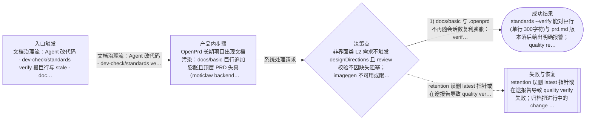
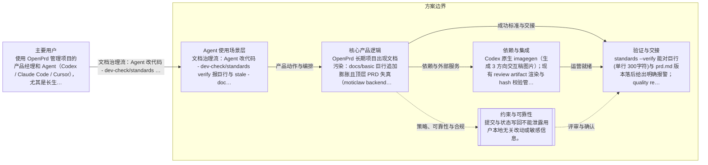

# 文档反污染治理与界面需求3方向交互稿评审
> 语言规则：用户可见说明、PRD、spec 和 tasks 跟随用户当前主语言；无法判断时才使用简体中文兜底。PRD、OpenPrd、OpenSpec、API、SDK、CLI、TypeScript、JSON、HTTP、WebSocket、字段 key、命令名、品牌名、产品名和协议名等必要专有名词保留原文。
- 版本: v0007
- 负责人: Codex
- 产品场景: 以 Agent 为主要使用场景
- 场景模板: 以 Agent 为主要使用场景
- 状态: synthesized
- 生成时间: 2026-07-03 14:45:25
## 元信息

- 标题: 文档反污染治理与界面需求3方向交互稿评审
- 负责人: Codex
- 状态: clarifying
- 版本: v0007
- 产品场景: 以 Agent 为主要使用场景
- 日期: 2026-07-03

## 问题

- 问题陈述: OpenPrd 长期项目出现文档污染：docs/basic 巨行追加膨胀且顶层 PRD 失真（moticlaw backend-structure.md 57KB/119行、prd.md 落后约170个需求版本），.openprd 内部产物无保留策略（quality/reports 5118 份 5.2GB、active 280 个版本目录从未归档）；同时 L1/L2 界面类需求的 3 方向效果图只散落在聊天里，评审结果不可回溯、不进固定评审界面。
- 为什么是现在: 6-7 月 475 个 Codex 会话实测显示门禁执行率高但拦不住污染，写入型会话仅 37% 更新过 docs/basic；用户已明确要求按 OpenSpec delta+archive 与 Superpowers 可视评审最佳实践立项优化。
- 证据:
  - moticlaw docs/basic 平均行长 440-477 字符、37 行超 500 字符；.openprd 总 5.8GB，quality/reports 5118 份；artifacts/active 280 个版本目录、archive 为 0；对照组 ClipReady/gifeasy 年轻项目文档健康。

## 用户与相关方

- 主要用户:
  - 使用 OpenPrd 管理项目的产品经理和 Agent（Codex / Claude Code / Cursor），尤其是长生命周期重度项目的维护者。
- 次要用户:
  - 待补充
- 相关方:
  - OpenPrd 维护者
  - 在脏仓库或长程任务中依赖 loop 的项目协作者

## 目标与成功标准

- 目标:
  - 1) docs/basic 与 .openprd 不再随会话数复利膨胀：verify 能发现巨行与 stale，报告有 retention，change 收口默认归档；2) L1/L2 界面类需求评审时，imagegen 生成的 3 方向交互稿进入固定 review.html 评审区块，用户在评审界面选定方向并结构化写回 selected-direction。
- 成功指标:
  - standards --verify 能对巨行(单行>300字符)与 prd.md 版本落后给出明确报警；quality reports 数量按策略收敛（保留 latest+近30份）；change 收口后 active 目录不再积压；review.html 出现 designDirections 区块且选定结果写回 .openprd/design/active/selected-direction.md；本地 Codex CLI 跑一个桌面任务时新流程可用。
- 验收目标:
  - 在 openprd 自身仓库通过单元测试与 standards/quality/run verify；用 Codex CLI 在本地跑一个桌面任务实测新流程效果并留下证据。

## 验证与创业闭环

- 可触达社区:
  - 待补充
- 第一批种子用户:
  - 待补充
- 社区契合与触达依据:
  - 待补充
- 当前替代方案: 待补充
- 痛点与替代证据:
  - 待补充
- 手工交付路径:
  - 待补充
- 手工作战卡:
  - 待补充
- 承诺信号:
  - 待补充
- 首个低成本验证: synthesize 生成 PRD 与 review.html 后走 change/tasks，再按任务实现并用 Codex CLI 本地桌面任务实测。
- 先活下来方案:
  - 待补充
- 付费验证信号:
  - 待补充
- 第一版只做一件事: 待补充
- 周末级验证: 待补充
- 最小工具桥接:
  - 待补充
- 产品化门槛:
  - 待补充
- 第一批客户路径:
  - 待补充
- 初始收费假设: 待补充
- 客户 1 盈利路径: 待补充
- 销售与增长纪律:
  - 待补充
- 可逆性判断: 待补充
- 客户真问题校验: 待补充
- 价值观一致性: 待补充

## 范围与非目标

- 范围内:
  - A1 standards verify 增加 docs/basic 巨行与 stale 质量检查；A2 quality/reports 与 harness 证据 retention 清理；A3 docs-compact 压缩建议工具与 change 收口默认归档；B1 review-presentation 合同新增 designDirections 区块（3 方向图 + 审美主张 + 避开项 + 选择状态）；B2 review.html 渲染 3 方向评审卡片并支持选定/驳回回写；同步更新 skills 生成源与 docs/basic 文档。
- 范围外:
  - 不改 Codex imagegen skill 本身；不做存量项目（moticlaw 等）的一次性人工清理，仅提供工具与报警；不新增 OpenPrd 自有生图 API；不改 canvas 桥接协议；不动无人值守 automation-safe 行为。

## 场景与流程

- 主流程:
  - 文档治理流：Agent 改代码 -> dev-check/standards verify 报巨行与 stale -> docs-compact 给出压缩重写建议 -> change 收口自动归档 active 版本目录并按 retention 清理报告。设计评审流：L2 界面需求 -> design brief -> imagegen 3 方向交互稿 -> 登记 designDirections -> review-presentation 校验写入 -> review.html 展示 3 方向卡片 -> 用户选定 -> user-confirmed 写回 selected-direction.md -> 实现阶段 visual-compare 用选定方向做 reference。
- 边界情况:
  - 非界面类 L2 需求不触发 designDirections 且 review 校验不因缺失阻塞；imagegen 不可用或限流时评审可先出文字方向卡占位并明确标注待补图；旧版本快照没有 designDirections 字段时渲染保持向后兼容；docs/basic 文件本来就短小的年轻项目不误报膨胀。
- 失败模式:
  - retention 误删 latest 指针或在途报告导致 quality verify 失败；归档把进行中的 change 移走导致状态断裂；巨行检查阈值过严导致老项目 verify 永远红灯阻塞正常工作；review.html 选择回写通道失败导致方向确认丢失。

## 可视化图表

### 产品流程

### 架构

## 需求

- 功能需求:
  - standards verify 新增 docsQuality 检查（巨行、平均行长、prd.md 版本落后）；新增 openprd docs-compact 命令输出压缩重写建议稿；quality verify 后按 retention 策略清理旧报告（保留 latest + 最近 N）；change --archive 在收口路径默认执行；review-presentation --template 输出含 designDirections 的模板；review.html 渲染 3 方向卡片区块。
- 非功能需求:
  - 所有新检查默认 warning 级不阻塞存量项目，可通过 config 升级为 error；retention 清理幂等且不删 latest.json/index.json；review.html 保持零外部依赖单文件打开。
- 业务规则:
  - designDirections 仅在需求被判定涉及界面场景时要求；方向选定必须以 user-confirmed 来源写回；落选方向归档不删除。

## 业务护栏

- 成本来源:
  - imagegen 每方向一次调用，共 3 次；报告清理为本地文件操作无外部成本。
- 额度与限制:
  - docs-compact 单次只处理 docs/basic 下的标准文档；retention 默认保留最近 30 份报告可配置。
- 滥用防护:
  - docs-compact 重写稿默认写到 sibling draft 待确认，不直接覆盖原文档；retention 不触碰 evidence 目录中被 latest 报告引用的文件。
- 监控信号:
  - standards verify 输出 docsQuality 结果；doctor 输出 .openprd 体积与报告数量提示。
- 报警阈值:
  - 单行超 300 字符 warning；prd.md 落后最新版本超过 20 个版本 warning；quality/reports 超过 200 份提示清理。
- 止损动作:
  - 任一清理动作失败即中止并保留原状；归档失败回退为仅提示不移动。

## 约束、依赖与风险

- 技术约束:
  - 改动集中在 src/standards.js、src/quality.js、src/openspec/change-lifecycle.js、src/review-presentation.js、src/html-artifacts.js，新增 src/docs-compact.js；skills 生成源同步 openprd-shared / openprd-frontend-design / command-catalog。
- 合规要求:
  - 提交与状态写回不能泄露用户本地无关改动或敏感信息。
- 依赖:
  - Codex 原生 imagegen（生成 3 方向交互稿图片）；现有 review artifact 渲染与 hash 校验管线。
- 假设:
  - imagegen 由 Codex 原生 Image 2 提供，OpenPrd 只消费图片路径；review.html 静态打开，选择结果通过现有 canvas/browser handoff 或 review --mark 通道回传；巨行阈值默认 300 字符可配置。
- 风险:
  - 存量污染项目首次 verify 会出现大量报警，需要以 warning 分级而非 error 硬阻塞；retention 清理属于删除类动作，默认 dry-run 并只在 verify/doctor 提示，实际清理需要显式命令。
- 开放问题:
  - designDirections 选择回写默认走 review artifact 手动确认还是 canvas handoff 自动回传（本期先支持 review --mark 附带 direction 参数，canvas 自动回传后续增强）。

## 类型专项模块

- 类型: Agent 使用场景专项
- humanAgentContract: 用户决定是否进入 loop、是否要求 commit、是否接受 override；Agent 负责在安全前提下创建隔离执行环境，并维护状态与证据闭环。
- autonomyBoundary: Agent 可以在 loop 运行前准备 worktree、检查脏状态并收集 touched files，但不能在用户未授权 commit 的情况下自动提交，也不能在高风险脏仓库里静默绕过门禁。
- toolBoundary: 优先使用本地 Git 与 OpenPrd loop 状态完成这次能力，不引入新的远端托管或发布前置依赖。
- stateModel: change 进入 loop 后，先绑定隔离执行环境，再逐任务 run / verify / finish / commit，并把 worktree、branch、commit 与测试报告写回同一条状态链。
- evalPlan: 通过 loop 单测、worktree / dirty repo 场景测试、状态持久化测试，以及一次真实隔离 worktree 的串行回归验证这次改动。

## 交接

- 负责人: Codex
- 下一步: synthesize 生成 PRD 与 review.html 后走 change/tasks，再按任务实现并用 Codex CLI 本地桌面任务实测。
- 目标系统: openprd CLI 自身仓库（harness-engineer/openprd）。
