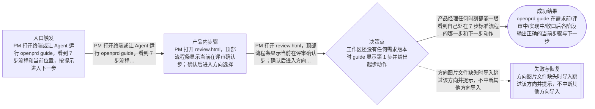
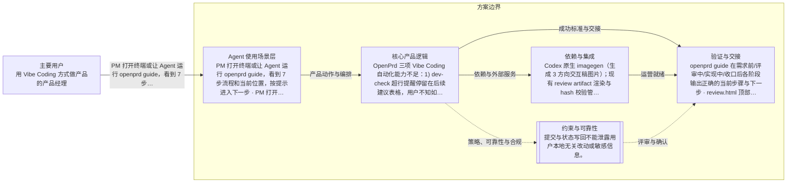

# PM 流程引导与画布评审协同（Human-in-the-loop 升级）
> 语言规则：用户可见说明、PRD、spec 和 tasks 跟随用户当前主语言；无法判断时才使用简体中文兜底。PRD、OpenPrd、OpenSpec、API、SDK、CLI、TypeScript、JSON、HTTP、WebSocket、字段 key、命令名、品牌名、产品名和协议名等必要专有名词保留原文。
- 版本: v0009
- 负责人: Codex
- 产品场景: 以 Agent 为主要使用场景
- 场景模板: 以 Agent 为主要使用场景
- 状态: synthesized
- 生成时间: 2026-07-03 18:26:19
## 元信息

- 标题: PM 流程引导与画布评审协同（Human-in-the-loop 升级）
- 负责人: Codex
- 状态: clarifying
- 版本: v0009
- 产品场景: 以 Agent 为主要使用场景
- 日期: 2026-07-03

## 问题

- 问题陈述: OpenPrd 三项 Vibe Coding 自动化能力不足：1) dev-check 超行提醒停留在后续建议表格，用户不知如何处理，价值鸡肋；2) 开发新功能时图标最佳实践路由几乎从不自动触发（415 个图标相关会话仅 1 次真实接入图标库）；3) 拼图/网格对齐证据板真实触发率低，证据图不在对话流中可视化，AI 自我审查作用未发挥。
- 为什么是现在: 用户明确反馈不少人用了 OpenPrd 觉得疑惑它到底是干嘛的，希望有一套软件工程视角的标准流程引导；画布做了一半，需要继续对标白板工具补齐人机协同能力。
- 证据:
  - moticlaw docs/basic 平均行长 440-477 字符、37 行超 500 字符；.openprd 总 5.8GB，quality/reports 5118 份；artifacts/active 280 个版本目录、archive 为 0；对照组 ClipReady/gifeasy 年轻项目文档健康。

## 用户与相关方

- 主要用户:
  - 用 Vibe Coding 方式做产品的产品经理
- 次要用户:
  - 待补充
- 相关方:
  - OpenPrd 维护者
  - 在脏仓库或长程任务中依赖 loop 的项目协作者

## 目标与成功标准

- 目标:
  - 产品经理任何时刻都能一眼看到自己处在 7 步标准流程的哪一步和下一步动作
  - 画布接入评审方向导入与流程位置提示，让 PM 在白板上完成方向标注并把结论发回 Agent
- 成功指标:
  - openprd guide 在需求前/评审中/实现中/收口后各阶段输出正确的当前步骤与下一步
  - review.html 顶部展示流程位置条
  - 画布可一键导入当前评审的 designDirections 方向图卡片
- 验收目标:
  - 在 openprd 自身仓库通过单元测试与 standards/quality/run verify；用 Codex CLI 在本地跑一个桌面任务实测新流程效果并留下证据。

## 验证与创业闭环

- 可触达社区:
  - 待补充
- 第一批种子用户:
  - 待补充
- 社区契合与触达依据:
  - 待补充
- 当前替代方案: 待补充
- 痛点与替代证据:
  - 待补充
- 手工交付路径:
  - 待补充
- 手工作战卡:
  - 待补充
- 承诺信号:
  - 待补充
- 首个低成本验证: synthesize 生成 PRD 与 review.html 后走 change/tasks，再按任务实现并用 Codex CLI 本地桌面任务实测。
- 先活下来方案:
  - 待补充
- 付费验证信号:
  - 待补充
- 第一版只做一件事: 待补充
- 周末级验证: 待补充
- 最小工具桥接:
  - 待补充
- 产品化门槛:
  - 待补充
- 第一批客户路径:
  - 待补充
- 初始收费假设: 待补充
- 客户 1 盈利路径: 待补充
- 销售与增长纪律:
  - 待补充
- 可逆性判断: 待补充
- 客户真问题校验: 待补充
- 价值观一致性: 待补充

## 范围与非目标

- 范围内:
  - dev-check 自动重构模式：默认开启，命中 attention/warning 时指示 Agent 本轮直接执行高内聚低耦合拆分（不丢功能），输出改为本次额外处理结果，并支持 --auto-refactor on/off 开关与收口确认话术
  - 图标最佳实践自动触发：asset-spec 增加功能图标行，design-starter/skills/catalog/hook 把新功能自动配图标写为默认行为
  - 拼图证据板强化：visual-compare 输出对话流嵌入 markdown，dev-check 对 UI 文件补视觉证据提醒，skills/catalog 把网格对齐证据板写为界面布局场景默认动作
- 范围外:
  - 画布实时多人协作
  - 重写画布为独立前端工程
  - 改动 Codex 线程桥接协议

## 场景与流程

- 主流程:
  - PM 打开终端或让 Agent 运行 openprd guide，看到 7 步流程和当前位置，按提示进入下一步
  - PM 打开 review.html，顶部流程条显示当前在评审确认步；确认后进入方向选择
  - PM 打开画布点导入评审方向，3 个方向图变成卡片，圈选标注后用发送给 Codex 把结论发回
- 边界情况:
  - 工作区还没有任何需求版本时 guide 显示第 1 步并给出起步动作
  - 当前评审没有 designDirections 时画布导入按钮提示暂无可导入方向
- 失败模式:
  - 方向图片文件缺失时导入跳过该方向并提示，不中断其他方向导入

## 可视化图表

### 产品流程

### 架构

## 需求

- 功能需求:
  - guide 命令基于工作区状态推断 7 步流程位置
  - review.html 渲染 stepper
  - canvas /api/review-directions 返回方向元数据与图片
  - canvas 前端导入方向卡片组
- 非功能需求:
  - 不新增外部依赖
  - guide 与画布 API 只读工作区状态，不写状态
  - 全部文案用 PM 能看懂的普通语言
- 业务规则:
  - designDirections 仅在需求被判定涉及界面场景时要求；方向选定必须以 user-confirmed 来源写回；落选方向归档不删除。

## 业务护栏

- 成本来源:
  - imagegen 每方向一次调用，共 3 次；报告清理为本地文件操作无外部成本。
- 额度与限制:
  - docs-compact 单次只处理 docs/basic 下的标准文档；retention 默认保留最近 30 份报告可配置。
- 滥用防护:
  - docs-compact 重写稿默认写到 sibling draft 待确认，不直接覆盖原文档；retention 不触碰 evidence 目录中被 latest 报告引用的文件。
- 监控信号:
  - standards verify 输出 docsQuality 结果；doctor 输出 .openprd 体积与报告数量提示。
- 报警阈值:
  - 单行超 300 字符 warning；prd.md 落后最新版本超过 20 个版本 warning；quality/reports 超过 200 份提示清理。
- 止损动作:
  - 任一清理动作失败即中止并保留原状；归档失败回退为仅提示不移动。

## 约束、依赖与风险

- 技术约束:
  - 改动集中在 src/standards.js、src/quality.js、src/openspec/change-lifecycle.js、src/review-presentation.js、src/html-artifacts.js，新增 src/docs-compact.js；skills 生成源同步 openprd-shared / openprd-frontend-design / command-catalog。
- 合规要求:
  - 提交与状态写回不能泄露用户本地无关改动或敏感信息。
- 依赖:
  - Codex 原生 imagegen（生成 3 方向交互稿图片）；现有 review artifact 渲染与 hash 校验管线。
- 假设:
  - imagegen 由 Codex 原生 Image 2 提供，OpenPrd 只消费图片路径；review.html 静态打开，选择结果通过现有 canvas/browser handoff 或 review --mark 通道回传；巨行阈值默认 300 字符可配置。
- 风险:
  - 流程步骤定义与既有 lane/gate 概念不完全一一对应，guide 只做展示层推断，不改门禁行为
- 开放问题:
  - 画布方向卡片是否需要内置投票/评分组件，留到下一轮看使用反馈

## 类型专项模块

- 类型: Agent 使用场景专项
- humanAgentContract: 用户决定是否进入 loop、是否要求 commit、是否接受 override；Agent 负责在安全前提下创建隔离执行环境，并维护状态与证据闭环。
- autonomyBoundary: Agent 可以在 loop 运行前准备 worktree、检查脏状态并收集 touched files，但不能在用户未授权 commit 的情况下自动提交，也不能在高风险脏仓库里静默绕过门禁。
- toolBoundary: 优先使用本地 Git 与 OpenPrd loop 状态完成这次能力，不引入新的远端托管或发布前置依赖。
- stateModel: change 进入 loop 后，先绑定隔离执行环境，再逐任务 run / verify / finish / commit，并把 worktree、branch、commit 与测试报告写回同一条状态链。
- evalPlan: 通过 loop 单测、worktree / dirty repo 场景测试、状态持久化测试，以及一次真实隔离 worktree 的串行回归验证这次改动。

## 交接

- 负责人: Codex
- 下一步: synthesize 生成 PRD 与 review.html 后走 change/tasks，再按任务实现并用 Codex CLI 本地桌面任务实测。
- 目标系统: openprd CLI 自身仓库（harness-engineer/openprd）。
