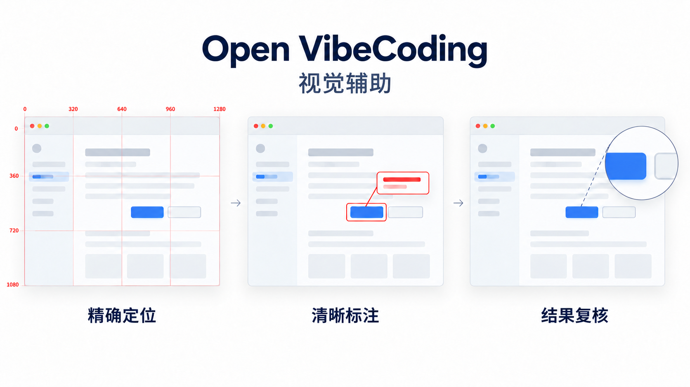
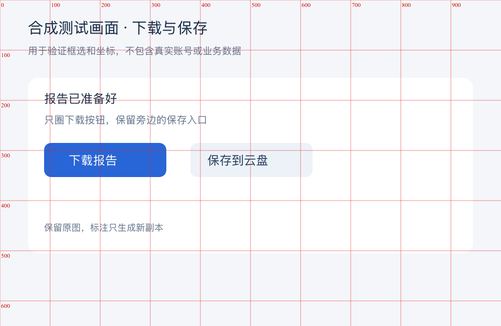
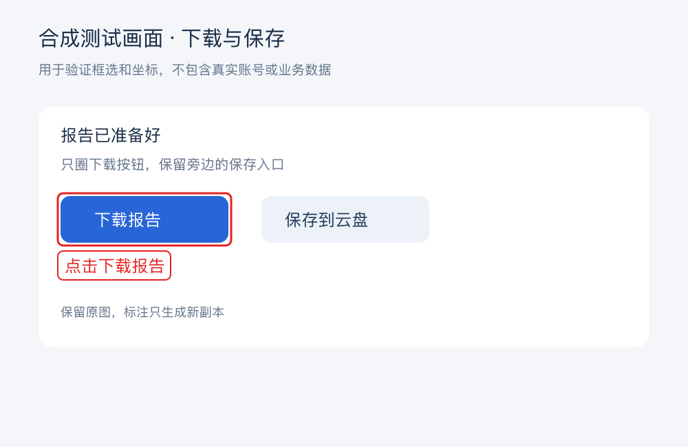

<a id="open-vibecoding"></a>

<div align="center">

# Open VibeCoding · Agent 协作能力框架

**按任务组合产品、设计、研发与测试能力。**

产品判断 · 交互设计 · 研发测试 · 视觉辅助

[](#readme-detail-audience)
[](#readme-detail-audience)

[✅ 适用场景](#readme-detail-audience) · [🧩 模块速查](#readme-detail-18) · [📁 能力结构](#readme-detail-8) · [📖 本地使用](#readme-detail-10) · [🤖 让 Agent 看准位置、圈清问题](#readme-detail-12) · [💡 工作原则](#readme-detail-14)

</div>

---

Open VibeCoding 为 Agent 提供产品、交互设计、研发、测试与 Vibe Coding 增强能力。用户直接描述目标；Agent 根据代码、会话与必要证据判断该用哪些能力。它不要求固定的起手命令，也不把五个领域排成必须依次完成的流程。

<a id="readme-detail-audience"></a>

## ✅ 适用场景

适合希望增强 Agent 项目协作能力的开发者。

<a id="readme-section-1"></a>

<a id="能力结构"></a>

<a id="readme-detail-8"></a>

## 📁 能力结构

| 领域 | 主要用途 |
| --- | --- |
| 产品 | 用户问题、竞品与需求诊断；按需调研和输出产品材料 |
| 交互设计 | 信息架构、路径、状态、视觉方向与实现对比 |
| 研发 | Agent 自主拆解和实现；CLI 提供确定性工具与运行态支持 |
| 测试 | 按风险选取最小足够验证，保留真正需要的证据 |
| Vibe Coding 增强 | 视觉精确定位与图片标注、图标获取、音频证据、画布、工具选择与经验复用 |
| 最佳实践（横向板块） | 根据项目条件选择适用实践；包括 iOS 多语言、收款通知与可选卡片模板 |

每个场景是独立子能力，统筹层按用户意图组合它们，不靠固定关键词匹配。小任务可以只用一项；复杂任务可在领域之间往返。`skills/open-vibecoding-router/SKILL.md` 是 Agent 的入口，`open-vibecoding capabilities list|get|contract` 提供机器可读的能力目录。项目可用 `open-vibecoding.capabilities.json` 和对应的 repo-local Skill 增量扩展。

<a id="readme-section-2"></a>

<a id="本地使用"></a>

<a id="readme-detail-10"></a>

## 📖 本地使用

```bash
open-vibecoding init .
open-vibecoding capabilities list
open-vibecoding doctor .
open-vibecoding run . --verify
```

可执行命令统一为 `open-vibecoding`，工作区路径为 `.open-vibecoding/`，场景 Skill 使用 `open-vibecoding-*`。不再安装旧名称入口。未安装全局命令时，可使用项目 `AGENTS.md` 中的本地 Node CLI 入口。旧版生成与推进命令已移除；已有历史记录可单独归档，不作为新版初始化输入。具体子命令以 `open-vibecoding --help` 为准。

架构与兼容边界见 [Open VibeCoding 架构](./docs/basic/open-vibecoding-architecture.md)，开发验证见 [应用流程](./docs/basic/app-flow.md) 和 [后端结构](./docs/basic/backend-structure.md)。

<a id="readme-section-3"></a>

<a id="让-agent-看准位置圈清问题"></a>

<a id="design-context"></a>

## 新界面先融入已有产品

给已有产品增加一个评价弹窗，即使只要一张效果图，Agent 也应先查看目标界面、相关截图和样式组件，再把实际参考带入生图，交付前自行对照。深色、紧凑的插件不应无依据变成白色、宽松的网页卡片。

这项内部能力由交互设计、效果图评审和视觉实现共同复用。用户要一张就出一张；需要探索时才比较多个方向。用户明确要求换风格或真正从零设计时，按实际目标处理。菜单保持简短，Agent 读取的适用场景说明完整保留。

## 界面精修有具体依据

后台显得杂乱时，Agent 会结合用户任务，检查信息层级、对齐、间距、字体、色彩、图标与表面，说明每项调整改善了什么。已有产品继续沿用自己的设计语言，局部调整保持原范围；图表的数据含义、文字可读性和操作能力一起核对。

[视觉层级与精修](skills/open-vibecoding-visual-refinement/SKILL.md) 是交互设计模块的内部能力，供效果图生成、界面实现和评审共同复用，不增加用户起手指令。具体用法见[场景案例](skills/open-vibecoding-visual-refinement/references/scenarios.md)。

## 按项目选择收款通知模板

支付成功后需要通知团队时，Agent 可以复用[收款通知规范与可选模板](skills/open-vibecoding-payment-notification/SKILL.md)。先查看项目已有支付与通知机制，再让用户选择采用[紧凑绿色飞书收款卡](skills/open-vibecoding-payment-notification/references/templates/feishu/payment-compact/v1/README.md)、调整后采用或保留现有样式。

选定模板后复制到目标项目，按项目币种、语言、时区和品牌配置。CLI 用于辅助接入与核验，上线后的发送由业务项目负责。公共工具只提供轻量规范和模板，不包含个人应用、群、凭证或财务运行服务；更新公共模板不会覆盖项目已定制的业务副本。

## 成品只讲用户需要的内容

Agent 的开发过程、制作说明和内部规则用于指导工作，不应出现在界面、效果图、文案与导出内容中。内置内容边界能力在生成前区分工作指令与可见文字，交付前查看实际结果；发现问题时修正源头并复查同组产物。必要的操作反馈与业务风险继续保留，用户明确要求的方法说明进入指定文档。

<a id="readme-detail-12"></a>

## 🤖 让 Agent 看准位置、圈清问题

让 Agent 按截图调整按钮位置、对齐卡片，或圈出需要修改的内容时，缩放和裁切关系不明确容易带来偏移。Open VibeCoding 将视觉定位与图片标注拆成两个内部子能力，供设计、研发和测试按场景复用，用户直接描述想改什么即可。



| 场景 | Agent 使用的方法 |
| --- | --- |
| 按图调整间距、添加元素或定位细小目标 | 主动生成红色像素网格，结合局部放大确定边界；核对缩放、裁切和坐标原点 |
| 圈出问题、说明操作位置或制作标注图 | 框住完整操作单元，添加动作标签，检查文字遮挡、越界与相邻控件 |
| 修改完成后检查效果 | 查看无网格结果与关键局部，检查目标是否准确、周边是否误改；几何检查不替代视觉复核 |

用网格定位目标，再用无网格标注图说明操作位置。

| 定位辅助副本 | 无网格标注副本 |
| --- | --- |
|  |  |

网格只在需要精确位置判断时使用，不强制每次看图都生成。原图与已有版本不覆盖；坐标关系不明、计划与源图不一致或标签没有安全位置时，工具会拒绝相应处理。它不保证模型判断绝对准确，也不会把图片像素直接当成屏幕点击或 CSS 坐标。

查看[使用场景、可复现样例与工具边界](./docs/visual-assistance.md)。两个能力均为 Agent 内部工具，不新增用户必选命令，也不依赖个人电脑上的截图标注 Skill。

<a id="readme-section-4"></a>

<a id="工作原则"></a>

<a id="readme-detail-14"></a>

## 💡 工作原则

- 界面视觉审查要求在最终回复展示实际截图：有确认参考时对比参考与实现，没有参考时展示最终实际界面。
- 查看[能力画册](./docs/capability-gallery.md)，按业务场景了解图标、设计评审、真实验收与诊断等增强方法。
- Agent 保留自己的思考、计划与执行方式；工具只提醒关键判断、提供可组合的确定性动作。
- 不自动生成 requirement、PRD、review、change 或 tasks，也不在后台为留痕补写它们。复杂任务可以由 Agent 自主拆解并逐项完成。
- 代码是默认的实现说明；用户要求的产品文档、审查页面和设计稿仍可作为真正的交付物制作。
- 视觉参照及实现对比、风险验证结果、外部动作读回等无法从代码可靠重建的证据按需保留。
- 已有 `.open-vibecoding/` 历史 PRD、change、spec 和 tasks 保持只读，不迁移、回填或改写。

<a id="readme-section-5"></a>

<a id="进一步阅读"></a>

<a id="readme-detail-16"></a>

## 📚 进一步阅读

- [贡献指南](CONTRIBUTING.md)
- [安全反馈](SECURITY.md)

<a id="readme-section-6"></a>

<a id="仓库导航"></a>

<a id="readme-detail-18"></a>

## 🧩 模块速查

按要处理的工作选择入口，先看模块职责，再进入对应文件或目录。

| 模块入口 | 负责什么 | 什么时候看 |
| --- | --- | --- |
| [`docs/`](docs/) | 项目说明与参考文档 | 查阅运行、设计与维护约定 |
| [`package.json`](package.json) | 依赖、开发与验证命令 | 核对依赖、工程目标与现有命令 |
| [`scripts/`](scripts/) | 开发与维护脚本 | 查找构建、验证或维护的现有命令 |
| [`skills/`](skills/) | Agent 技能模块 | 查找具体场景对应的技能入口 |
| [`src/`](src/) | 应用或服务实现 | 定位应用界面与业务实现 |
| [`test/`](test/) | 自动化测试 | 为修改选择对应的回归检查 |
