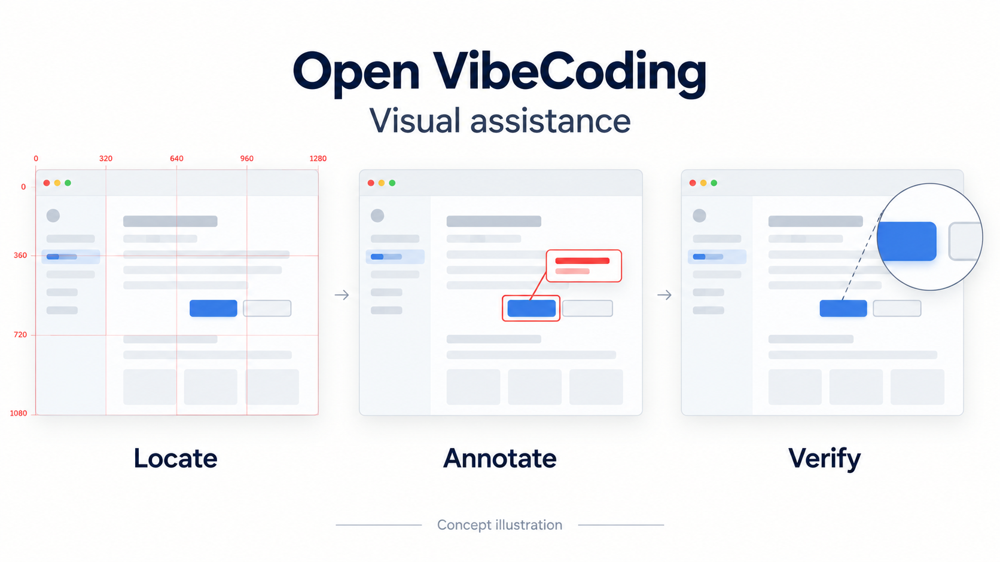
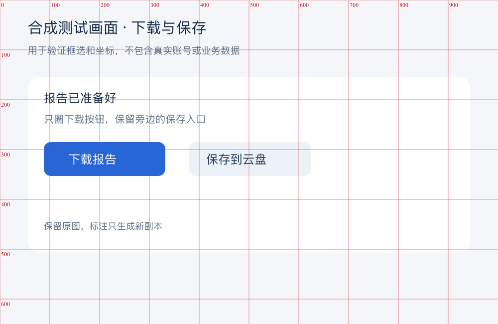

# Open VibeCoding

[简体中文](./README.md) | English

Open VibeCoding equips agents with product, interaction design, development, testing, and Vibe Coding enhancement capabilities. Users describe their goal directly; the agent selects and combines relevant capabilities without a mandatory sequence.

## Capabilities

| Domain | Purpose |
| --- | --- |
| Product | Diagnose user problems, competitors, and requirements; research or produce product materials when useful |
| Interaction design | Shape information architecture, journeys, states, visual directions, and implementation comparisons |
| Development | Let the agent plan and implement; use the CLI for deterministic tools and runtime support |
| Testing | Select risk-appropriate verification and retain necessary evidence |
| Vibe Coding enhancement | Precise visual localization, image annotation, icons, audio evidence, canvas collaboration, tool selection, and reusable knowledge |
| Best practices (cross-cutting) | Choose verified modern approaches within project constraints; the first independent topic is iOS localization with String Catalogs |

Each scenario is an independent child capability. The orchestration layer composes them by user intent and evidence, not fixed keyword matching. Simple tasks may need only one; complex tasks can move between domains. `skills/open-vibecoding-router/SKILL.md` is the agent entry point, and `open-vibecoding capabilities list|get|contract` exposes the machine-readable catalog. Projects can add scenarios through an optional `open-vibecoding.capabilities.json` and matching repo-local skills.

## Help agents locate and annotate visual targets

Moving a button from a screenshot, aligning cards, or highlighting an issue requires a clear relationship between image pixels, preview scale, and crop origins. Open VibeCoding provides two independent internal capabilities for visual localization and image annotation. Design, development, and testing scenarios can reuse them while users simply describe the intended result.



| Situation | Method |
| --- | --- |
| Adjust spacing, insert content, or locate a small target | Use a red pixel grid and close-up inspection; verify scale, crop, and origin before acting |
| Highlight an issue or explain an action | Frame the complete target, place a short label, and check protected text, neighboring controls, and canvas bounds |
| Verify a change | Inspect the clean result and relevant details; geometry checks do not replace visual review |

These are actual built-in tool outputs from one synthetic test image. They contain no real account or business data; the Chinese labels are part of the fixture.

| Coordinate guide | Grid-free annotation |
| --- | --- |
|  |  |

Grids are used when accurate position matters, not for every image-understanding task. Originals and existing outputs are protected. Unclear mappings, stale source bindings, and unsafe label layouts require correction. The tools cannot guarantee model judgment or turn image pixels directly into screen clicks or CSS coordinates.

See the [use cases, reproducible example, and limitations](./docs/visual-assistance.en.md). Both capabilities are internal agent helpers, with no extra user-facing entry point or dependency on a personal screenshot-annotation Skill.

## Principles

- Interface visual reviews require actual screenshots embedded in the final reply: reference and implementation when an approved reference exists, or the final running interface otherwise.
- Browse the [capability gallery](./docs/capability-gallery.en.md) for scenario-based examples of icons, design review, acceptance, audio, and diagnostics.
- The agent owns its reasoning, plan, and execution. The toolkit provides reminders and composable deterministic actions.
- It does not automatically generate requirements, PRDs, reviews, changes, or task files for workflow bookkeeping.
- Code is the default implementation documentation. Documents, design artifacts, and review pages remain valid user-requested deliverables.
- Preserve evidence that cannot be reliably reconstructed from code, such as visual references and comparisons, risk verification, and external action read-backs.
- Existing `.open-vibecoding/` PRDs, changes, specs, and tasks remain read-only historical records; they are not backfilled or rewritten.

## Local usage

```bash
open-vibecoding init .
open-vibecoding capabilities list
open-vibecoding doctor .
open-vibecoding run . --verify
```

The executable is `open-vibecoding`, workspace data lives in `.open-vibecoding/`, and scene skills use `open-vibecoding-*`. Legacy entry points are no longer installed. Without a global installation, use the local Node CLI entry recorded in the project's `AGENTS.md`. Old generation and advancement commands are removed; legacy records can be archived separately rather than reused as initialization input. See `open-vibecoding --help` for available commands.

See the [architecture](./docs/basic/open-vibecoding-architecture.md), [application flow](./docs/basic/app-flow.md), and [backend structure](./docs/basic/backend-structure.md).
