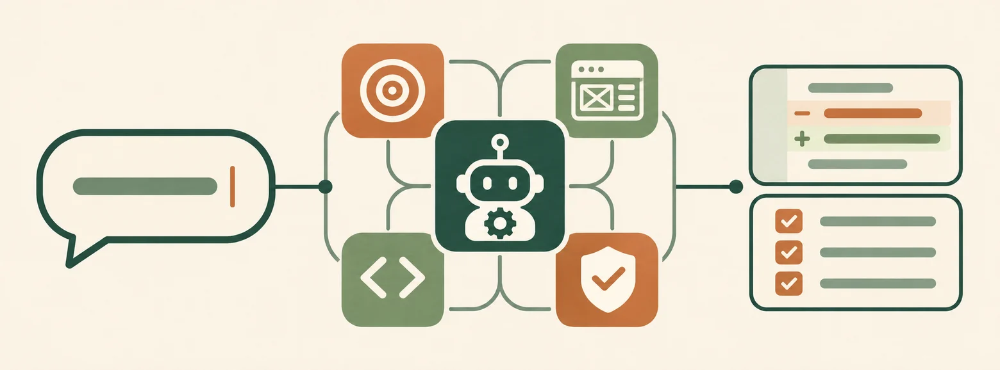

# Open VibeCoding

**Give your coding agent product, design, engineering, and testing skills it can use as the task calls for them.**

Use it in an existing repository with Codex, Claude Code, Cursor, or Gemini CLI. Describe what you want to achieve. The agent draws on the repository and any knowledge sources you connect to decide how to plan, implement, and verify the work.

[Quick start](#quick-start) · [Use cases](#use-cases) · [Capability gallery](./docs/capability-gallery.en.md) · [Releases](https://github.com/mileson/open-vibecoding/releases) · [简体中文](./README.md)



## Quick start

You’ll need Node.js 20.19 or later and a coding agent you already use. Run these commands in your project directory.

```sh
npm install -g https://github.com/mileson/open-vibecoding/releases/download/v0.4.7/open-vibecoding-0.4.7.tgz
open-vibecoding init .
```

Open your project with your agent and give it a concrete task.

> Add a dark mode toggle to Settings. Check the project’s current theming and settings first, then implement the toggle and verify that the choice persists after restart.

The agent uses the project guidance to find skills that fit the task. On an existing Open VibeCoding project, install the new version and run `open-vibecoding update .`. Check the installation with `open-vibecoding doctor .`.

## Use cases

| What you want to do | What you can get |
| --- | --- |
| Decide which part of sign-up to improve first | A user problem, supporting evidence, and a direction you can test |
| Add a screen to an existing product | A design or implementation consistent with the product, with visual comparisons |
| Build a feature or diagnose a bug | Code changes, key decisions, and verification results |
| Validate a form, menu, or cross-platform flow | Test cases, actual run results, and evidence you can review |
| Give the agent existing project guidance | Citations with local line numbers or links to the original Feishu Wiki documents |

## Explore the capabilities

- Use `open-vibecoding capabilities list` to discover skills. Project skills live in `.agents/skills/` and can be shared through Git.
- Connect Markdown directories or Feishu Wiki subtrees with `open-vibecoding knowledge bind --help`. New installations start with empty bindings.
- See the [capability gallery](./docs/capability-gallery.en.md) for visual examples and the [visual assistance guide](./docs/visual-assistance.en.md) for a reproducible annotation example.
- See the [test report guide](./docs/test-report.md) for reports and acceptance runs, and [project quality checks](./docs/project-quality.md) to connect project rules to tests and CI.
- Read the [contributing guide](./CONTRIBUTING.md) or [security policy](./SECURITY.md).

Detailed command examples and feature guides are linked from the [Chinese README](./README.md).
