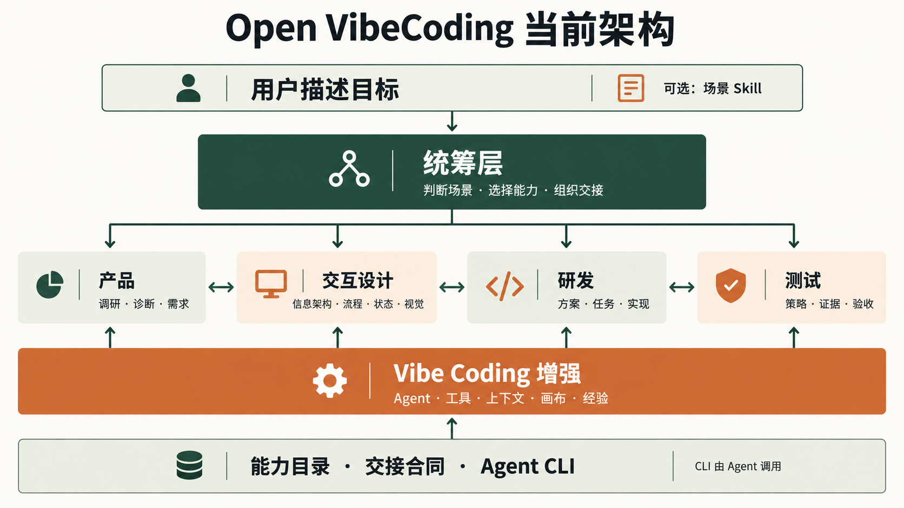

# Open VibeCoding 架构



这张教程图展示能力关系；各能力的当前覆盖范围与兼容状态以下文为准。

## 入口与能力边界

用户直接描述目标。Agent 先使用 `open-vibecoding-router` 识别当前场景和证据缺口，选择一个或多个场景 Skill；用户也可以显式调用某个场景 Skill。CLI 只供 Agent 执行精确动作，不要求用户选择 `from-idea`、`from-reference` 或 `continue-project` 一类流程指令。

| 能力域 | 独立场景子能力 | 主要工具 |
| --- | --- | --- |
| 产品 | 产品诊断、用户与市场调研、竞品分析、产品使用数据分析、按需产品文档 | benchmark、brainstorm、已有数据源或导出数据 |
| 交互设计 | 交互评审、视觉方向评审、视觉实现与对比 | diagram、design-starter、visual-prepare、visual-compare |
| 研发 | 功能实现、故障定位与修复、重构与质量改善、内部诊断补强 | runtime、dev-check、项目已有日志与测量设施 |
| 测试 | 测试策略、验收与回归、独立界面交互 Review、Review 并修复、线上异常分析与跟踪 | run、validate、visual-compare、宿主 subagent / Computer Use、已有监控或日志 |
| Vibe Coding 增强 | 工具选择、画布、经验复用、音频与语音证据、图标统筹/检索/SVG/生图/透明化 | capabilities、doctor、canvas、quality、grow、icon-cutout |
| 最佳实践（横向板块） | 实践选择、iOS 多语言；按平台与主题独立扩展 | capabilities、benchmark、按当前项目选择的验证工具 |

五个执行能力域之外新增横向“最佳实践”板块，供各域按需调用，不增加必经流程。目录以 `best-practices` 注册该板块。简单任务可以只调用一个能力；复杂任务才拼接多个领域，允许往返。PRD、change、tasks 不是默认产物或后台作业。

## 场景 Skill 与 CLI

- 每个场景有独立 Skill 和目录条目，声明适用意图、输入、输出和必要的质量判断。Agent 按用户目标与现有证据语义选用，不使用固定关键词匹配；可选的斜杠入口只是显式调用方式。
- CLI 提供确定性读取、写入、验证和能力发现。`open-vibecoding capabilities list|get|contract` 默认输出 JSON，供 Agent 查询注册能力与交接字段；不再提供旧名称命令。
- `src/capability-catalog.js` 是包内能力声明源。项目可在根目录提供可选的 `open-vibecoding.capabilities.json`，注册额外领域或场景；每个扩展场景须有唯一的 `skills/<skill-id>/SKILL.md`。`capabilities list|get --path <项目>` 会读取并校验清单；`init/update` 将项目 Skill 安装到 Codex/Claude 适配目录。清单不执行扩展代码，也不以输入词语自动派发。
- `skills/` 是此产品的 repo-local Skill 源；`CANONICAL_SKILLS` 将它们生成到 Codex/Claude 等消费者。个人 `~/.codex/skills` 不是包内 canonical source。

项目新增场景的最小清单如下；`accepts` 说明可接收的材料，不是触发词：

```json
{
  "schema": "open-vibecoding.contributions.v1",
  "scenarios": [{
    "id": "content-audit",
    "title": "内容审查",
    "skill": "example-content-audit",
    "domains": ["product"],
    "accepts": ["现有内容与用户任务"],
    "produces": ["内容缺口与可验证的改进建议"]
  }]
}
```

CLI 发现入口借鉴 `lark-cli` 的层级思想；Open VibeCoding 当前处理本地工作区流程，因此没有为其虚构原始 HTTP API 层。

### 测试能力的组合

`ui-interaction-review` 由独立 reviewer 通过 Computer Use 实际操作运行界面，输出问题、复现证据和覆盖缺口，不修改产品代码。`ui-review-and-repair` 是单独的组合场景，通过 `uses: ["ui-interaction-review", "debugging"]` 复用审查和修复能力：reviewer 检查，另一个 fixer 修复，再由 reviewer 复测。默认最多三轮修复与复查，用户预算优先；修复完成但未实际复测的问题不能算关闭。

项目扩展场景也可声明可选的 `uses` 非空数组，引用已注册场景 ID。目录校验未知引用、重复引用和循环依赖，支持嵌套组合与前向引用。这里的无环关系是静态能力依赖，不限制 Agent 在运行时重复 review / repair；目录不执行任务，也不规定思考步骤。未声明 `uses` 的现有场景保持兼容。

Reviewer 必须实际具备 Computer Use；缺少工具或运行环境时明确未验证范围，不用源码审查冒充界面实测。多 Agent 串行交接同一个任务专用浏览器的操作权，不同时控制页面，不为迭代额外生成 PRD/change/tasks。

### 数据分析与外部可选工具

`product-data-analysis` 分析实际使用数据，解释转化、留存等业务变化；`production-anomaly-analysis` 分析线上崩溃、错误及修复后的复发情况。两个独立场景只包含轻量方法，通过 `uses: ["tool-selection"]` 复用工具选择，不强制安装或绑定厂商。

已有 MCP、CLI、报表或导出数据足够时直接使用；缺失时按需推荐并经用户同意引导接入。厂商 Skill、SDK、查询实现、凭证、个人产品映射和常驻服务不随这两个场景分发。复杂外部 Skill 仅在实际可用且确有需要时加载。项目增量清单用于分发项目内 Skill，不用于登记尚未安装的可选外部工具；本轮未新增插件管理或安装机制。

各产品复用自己的私有配置绑定远端项目和环境，凭证只保留安全引用，不要求创建固定配置或报告。查询连接、应用采集和线上发布分别验证；空结果不等于无故障，修复后暂未再发生不等于已验证修复。分析默认只读，修复、发布、平台状态修改和定时跟踪遵循各自授权范围。

### 修复与优化后的诊断补强

内部子能力 `diagnostic-readiness` 归属研发，由排障、相关功能实现、重构和验收复用。主动判断相同问题复发时现有证据是否足够；不足时在已授权改动内补关键诊断与耗时信息，测试实际读回并检查可取得性。方法只维护在独立 Skill，最佳实践只提供索引。现有证据够用则复用，纯结构整理不机械加日志；不强制新 SDK、观测平台、报告或持续监控。线上异常分析复用这些证据，后续部署、外部上报与长期跟踪仍遵循实际授权。

## 交接合同

音频增强以 `open-vibecoding-audio-evidence` 为新版入口，旧 `open-vibecoding-audio-evidence` 方法源与媒体 schema 共用，兼容历史证据。图标增强用 `icon-system` 组合四个独立子能力：多渠道检索、SVG 设计、原生图标生成及透明化。检索渠道包括 Phosphor、LobeHub、TechIcons、Thiings 和 iconfont；按语义、产品风格、消费尺寸与许可选择，站点不作为固定触发器。原生透明图优先保留 alpha；纯色背景图可用本地 `icon-cutout`，实际视觉质量仍在消费组件里验收。

需要跨能力明确交接时可使用 `open-vibecoding.handoff.v1`：`scenarioId`、`status`、`sourceRefs`、`facts`、`assumptions`、`unknowns`、`decisions`、`artifactRefs`、`evidenceRefs`、`nextActions`。`status` 只使用 `success`、`partial`、`blocked`、`unknown`。这不是每次任务都要创建的文件或状态。

当前已有五个执行域、横向最佳实践、独立场景子能力、项目级增量注册和交接校验合同。旧版 PRD/change/tasks 生成与推进入口已退役。新版初始化使用 `.open-vibecoding/`，不再分发旧名称的命令、Skill 或 Hook。旧项目专属内容移到统一归档位置，有效设计素材与证据按需迁入新版；不重写冻结历史。npm 发布与远端改名不属于本地迁移。

最佳实践入口 `practice-selection` 只根据项目条件加载适合的条目。首个主题 `ios-localization` 在 Xcode/CI 条件允许时优先 `.xcstrings`，调用 API 另查部署兼容；保留表/bundle 语义，验证迁移覆盖、实际打包和语言行为。一次项目迁移中合并主表的做法不成为通用约束。后续主题作为独立 Skill 注册，不扩大入口上下文，也不按固定关键词命中。

## 名称与兼容映射

用户场景名称采用“【环节】目标”，短描述说明具体方法与结果；分类和显示文案集中在 `src/skill-presentation.js`，不用于匹配提示词。现有 20 个用户场景保留自动选择能力。Codex 用户入口生成 `agents/openai.yaml`；18 个内部能力存于 `.open-vibecoding/harness/internal-skills/`，由 AGENTS、Hook 和路由映射按需读取，不依赖未证实的隐藏字段。Claude 的内部能力保留在其 skills 目录并设置 `user-invocable: false`。内部能力的完整方法、引用资源和项目自定义附加文件保留；更新已有项目时只迁移带受管标记的旧入口。

| 位置 | 当前正式值 | 兼容边界 |
| --- | --- | --- |
| 产品展示名 | Open VibeCoding | 历史发布名称不重写 |
| 本地源码目录 | `harness-engineer/open-vibecoding/` | 不保留旧源码目录入口 |
| 本地 npm 包与 CLI | `open-vibecoding` | 本地包只提供新版可执行名；未安装全局命令时使用安装清单记录的 `cliEntry` |
| 场景 Skill | `open-vibecoding-*` | 方法、引用与 Codex/Claude 生成物统一为新版名称 |
| 工作区数据 | `.open-vibecoding/` | 新初始化状态与旧历史分开；有效项目素材保留 |
| 环境变量和生成标记 | `OPEN_VIBECODING_HOME`、`OPEN_VIBECODING:GENERATED` | 本地安装使用新版标记；不修改用户全局配置 |
| GitHub 与 npm | 本轮仅本地迁移 | 不推送、不发布、不修改远端名称或可见性 |
