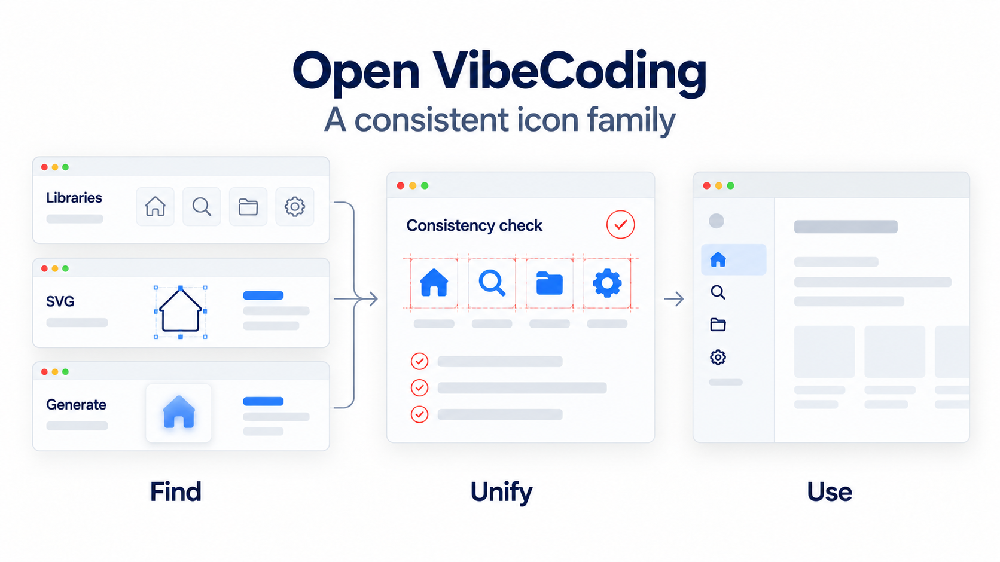
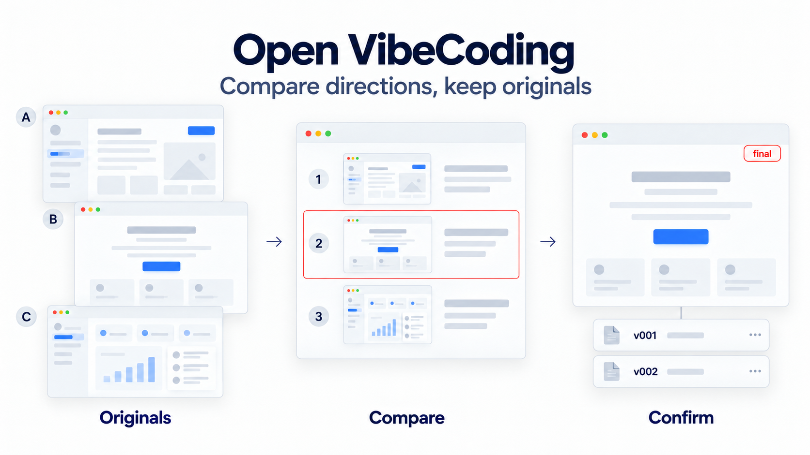
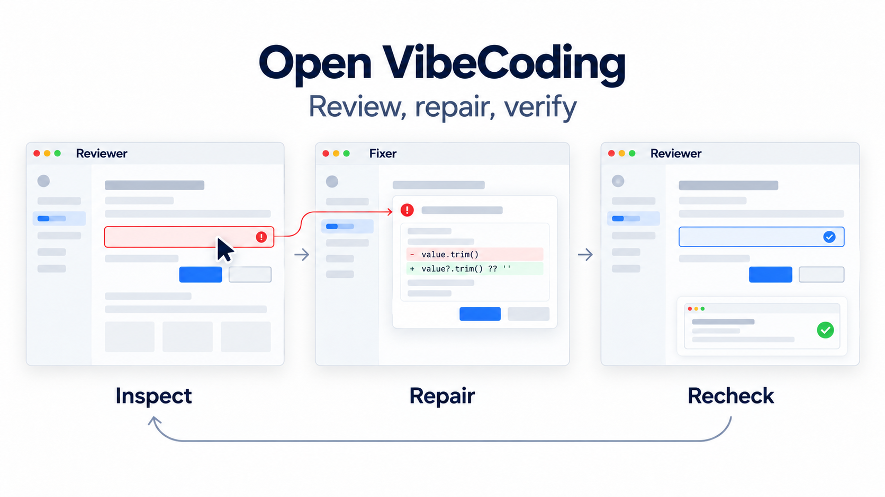
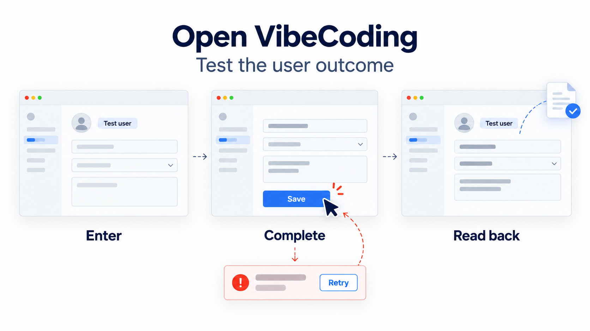
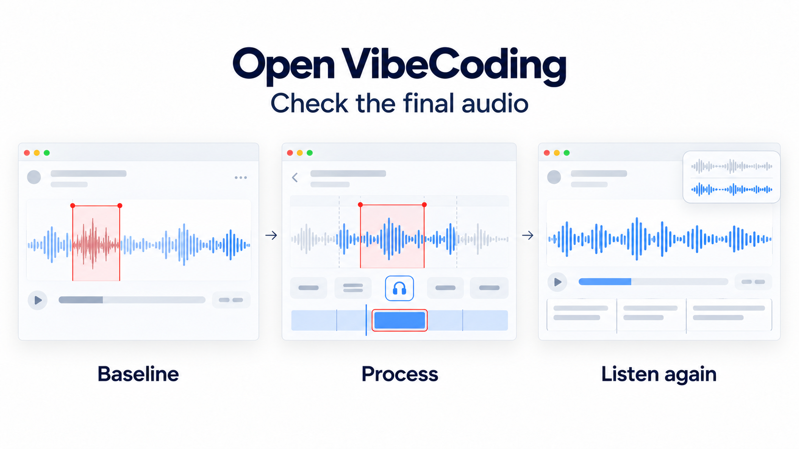
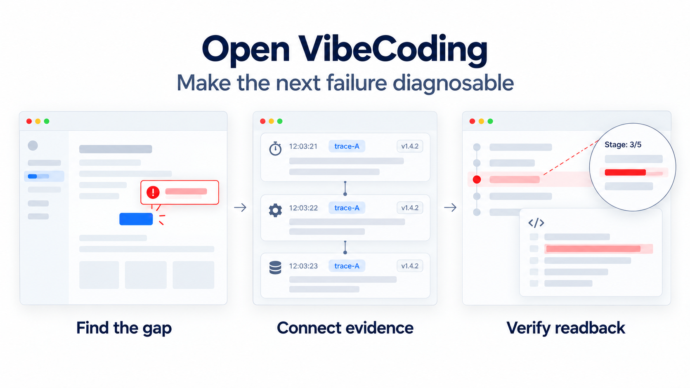
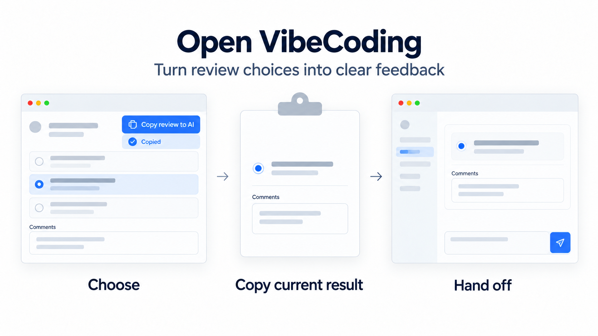

# Open VibeCoding capability gallery

[简体中文](./capability-gallery.md) | English

Describe what you want to accomplish. The agent selects methods for the situation. These eight examples show how the helpers can work independently or support product, interaction design, development, and testing.

## 1. Locate before adjusting

“Align this button with the input beside it.” When precise positioning matters, use a red pixel grid and close-up inspection to check the original image, scaling, and cropping. Add frames and action labels when explaining a target, then inspect the clean result without the grid.

Methods: [Visual localization](../skills/open-vibecoding-visual-localization/SKILL.md) · [Image annotation](../skills/open-vibecoding-image-annotation/SKILL.md) · [Reproducible tool examples](./visual-assistance.en.md)

## 2. Find a consistent icon family

“These navigation icons look like they belong to different products.” Inspect the existing family, then search libraries, draw SVGs, or generate bitmaps as needed. Match meaning, stroke weight, and visual balance, and check them in the actual interface.

Method: [Icon acquisition and style coordination](../skills/open-vibecoding-icon-system/SKILL.md)

## 3. Compare directions and keep the approved original

“Show me different directions before we build.” When the direction needs a meaningful comparison, generate distinct candidates. Save full originals and a numbered contact sheet in `design/<scene>/vNNN/`. After selection, final points to the approved original so implementation uses the same version. Small changes do not automatically require multiple directions.

Method: [Visual direction review](../skills/open-vibecoding-visual-direction-review/SKILL.md)

## 4. Review independently, repair, and recheck

“Try the interface yourself, find what is awkward, and fix it.” An independent reviewer operates the interface through Computer Use and passes reproducible findings to a fixer. The reviewer then returns to the same path to recheck. A review-only request does not authorize code changes.

Methods: [UI interaction review](../skills/open-vibecoding-ui-interaction-review/SKILL.md) · [Review and repair](../skills/open-vibecoding-ui-review-and-repair/SKILL.md)

## 5. Verify that the user's task actually succeeded

“It said saved, but is the content still there when I reopen it?” Reuse a safe test environment and follow the real entry path with Computer Use or existing web automation. Check reopened data, exported files, and failure recovery. Clickable buttons and successful builds do not establish the final business outcome.

Methods: [Testing strategy](../skills/open-vibecoding-test-strategy/SKILL.md) · [Acceptance and regression](../skills/open-vibecoding-acceptance-verification/SKILL.md)

## 6. Check the final exported audio

“Did noise reduction damage the voice?” Keep a baseline and inspect the listening quality and corresponding segments in the final media. Check recognition and subtitle issues against the actual audio, beyond editor settings or the subtitle page.

Method: [Audio and speech evidence](../skills/open-vibecoding-audio-evidence/SKILL.md)

## 7. Make the next recurrence diagnosable

“If it stalls again, will we know where?” After a fix or performance improvement, check diagnostic blind spots and reuse existing evidence. Add correlation, stage, and timing details only where needed, then actually read them back. Avoid routine log proliferation and do not automatically start long-term monitoring.

Method: [Diagnostic readiness](../skills/open-vibecoding-diagnostic-readiness/SKILL.md)

## 8. Hand review choices back to AI

“I chose B and added a few comments.” When an HTML review is needed, provide a consistent “Copy review to AI” button with a left-side copy icon and feedback status. Copy the current selection and comments so the user can paste them into the conversation. Do not send automatically.

Method: [HTML review handoff](../skills/open-vibecoding-harness/references/review-handoff.md)

## Show the actual result at delivery

Interface visual reviews and repairs require screenshots of the current running version embedded in the final reply. Show the approved reference alongside implementation when one exists; otherwise show the final actual interface. Include context and detail for small changes and screenshots for relevant states. If capture is unavailable, state that visual verification is incomplete. Screenshots do not replace business-result checks.

Method: [Visual evidence delivery](../skills/open-vibecoding-visual-evidence-delivery/SKILL.md). This internal helper is shared by the scenarios and adds no command the user must remember.
