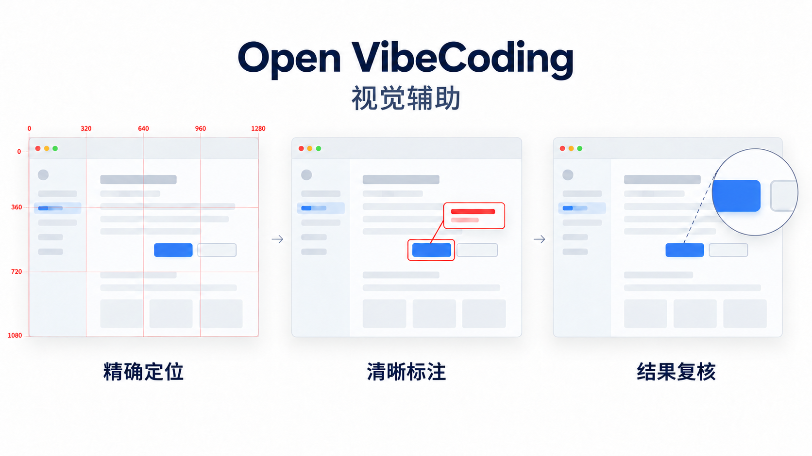
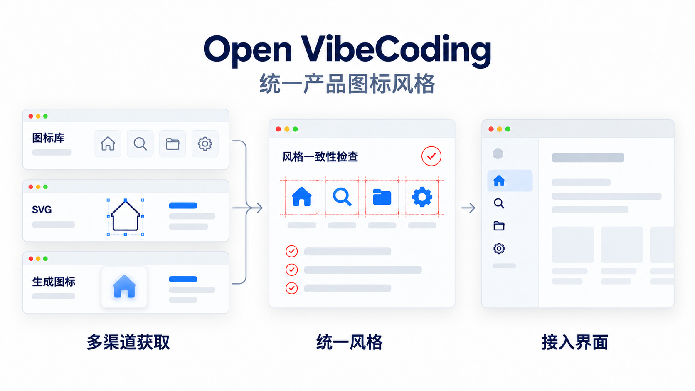
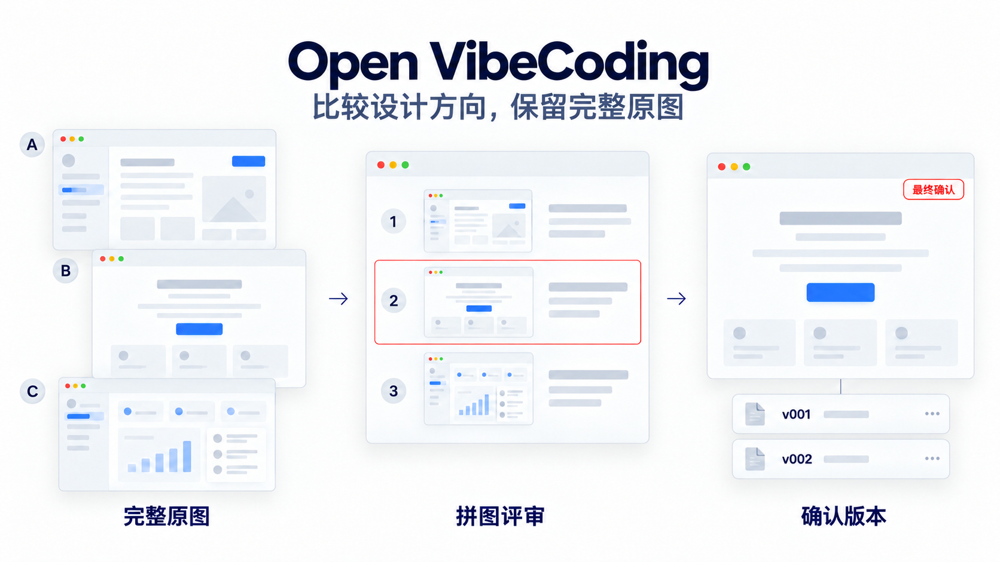
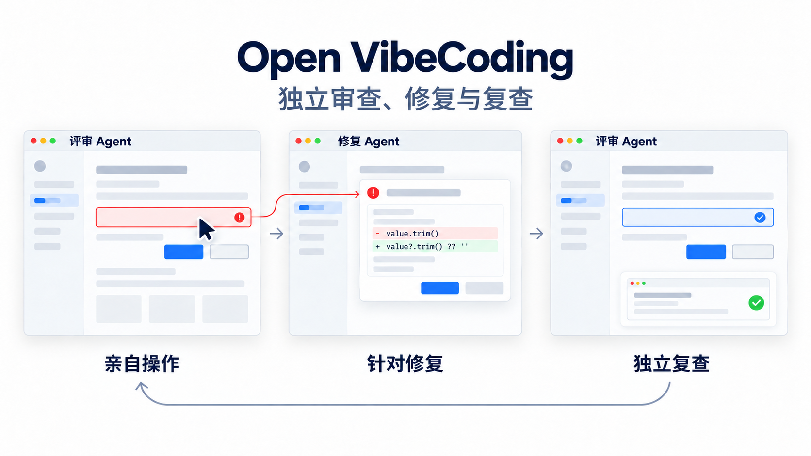
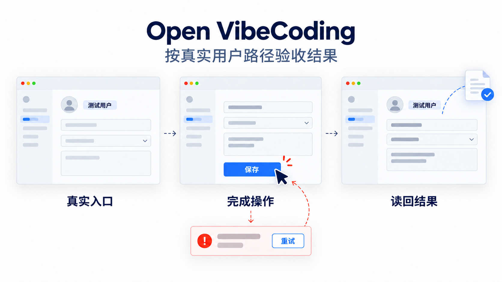
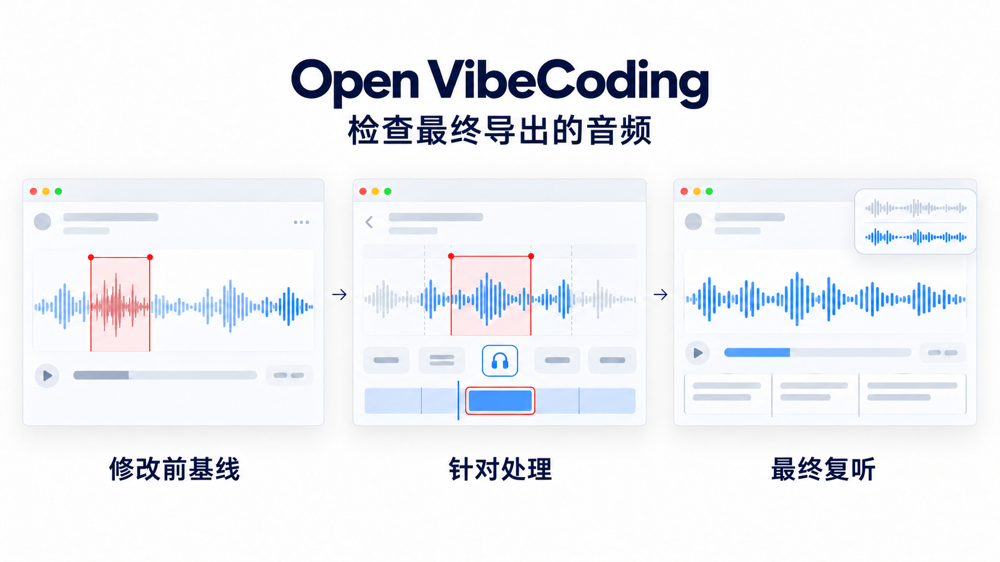
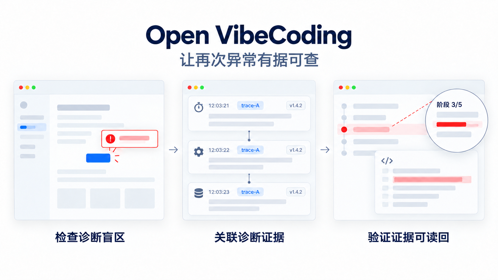
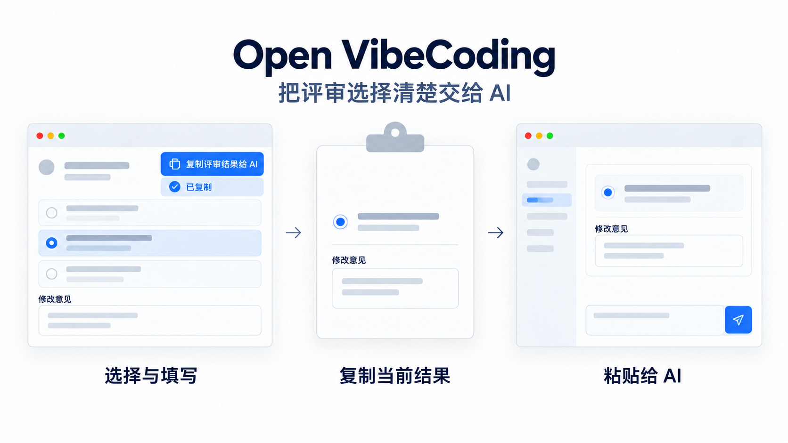

# Open VibeCoding 能力画册

简体中文 | [English](./capability-gallery.en.md)

直接描述想解决的事情，Agent 按场景选择方法。下面八个例子说明这些增强能力怎样帮上忙；它们可以独立使用，也能组合进产品、交互、研发与测试。

## 1. 按图调整，先看准位置

“把这个按钮和旁边的输入框对齐。”需要精确位置判断时，用红色像素网格与局部放大核对原图、缩放和裁切关系；需要说明问题时加框和动作标签，最后检查无网格结果。

方法：[视觉定位](../skills/open-vibecoding-visual-localization/SKILL.md) · [图片标注](../skills/open-vibecoding-image-annotation/SKILL.md) · [可复现工具样例](./visual-assistance.md)

## 2. 给产品找一套统一图标

“这些入口的图标看起来不像同一个产品。”先检查现有家族，再按需从图标库检索、绘制 SVG 或生成位图，统一语义、线宽和视觉重量，放回实际界面检查。

方法：[图标获取与风格统筹](../skills/open-vibecoding-icon-system/SKILL.md)

## 3. 比较设计方向，留下确认原图

“先给我几个不同方向，选好再开发。”有实质方向分歧时生成不同候选，原图和编号拼图一起保存在 `design/<scene>/vNNN/`；选定后用 final 指向确认原图，开发读取同一版本。小幅调整不机械升级为多方向评审。

方法：[视觉方向评审](../skills/open-vibecoding-visual-direction-review/SKILL.md)

## 4. 独立检查，再修复与复查

“你自己点一遍，找出难用的地方并改好。”独立 reviewer 用 Computer Use 亲自操作，把问题和复现依据交给 fixer；修改后再由 reviewer 回到同一路径复查。只要求检查时不自动改代码。

方法：[界面 Review](../skills/open-vibecoding-ui-interaction-review/SKILL.md) · [Review 并修复](../skills/open-vibecoding-ui-review-and-repair/SKILL.md)

## 5. 从测试用户角度确认事情办成了

“保存提示成功了，重新打开真的还在吗？”复用可安全操作的测试环境，用 Computer Use 或现有网页自动化走真实入口，检查保存后重开、导出文件和失败恢复。按钮可点和构建成功不替代最终业务结果。

方法：[测试策略](../skills/open-vibecoding-test-strategy/SKILL.md) · [验收与回归](../skills/open-vibecoding-acceptance-verification/SKILL.md)

## 6. 改完音频，检查最终导出的内容

“降噪后有没有把人声也损坏？”保留修改前基线，检查最终媒体的听感和对应片段；语音识别或字幕问题回到真实音频核对，不只检查编辑参数或字幕页面。

方法：[音频与语音证据](../skills/open-vibecoding-audio-evidence/SKILL.md)

## 7. 修好后，让下次异常有据可查

“这次好了，下次再卡住能知道卡在哪吗？”修复或性能优化时主动检查诊断盲区，复用已有证据，必要时补充关联信息、阶段和耗时，再实际读回。避免机械加日志，不自动开启长期监控。

方法：[修复后的可诊断性](../skills/open-vibecoding-diagnostic-readiness/SKILL.md)

## 8. 把评审选择一次交给 AI

“我选了 B，还写了几条意见。”需要 HTML 评审时，统一提供带左侧图标的“复制评审结果给 AI”按钮和状态反馈，复制当前选择及填写的意见，让用户粘贴后继续；不替用户自动发送。

方法：[HTML 评审交接](../skills/open-vibecoding-harness/references/review-handoff.md)

## 最后要看到实际结果

界面视觉审查与修复结束，Agent 在最终回复直接展示本轮实际截图。有确认稿就同时展示参考与实现，没有确认稿也展示最终实际界面；细节调整补上下文和局部，多状态任务展示对应状态。工具不可用时明确视觉未验证，截图也不能代替后台业务结果检查。

方法：[视觉结果交付](../skills/open-vibecoding-visual-evidence-delivery/SKILL.md)。它是供各场景复用的内部增强能力，不增加用户必须记住的命令。
